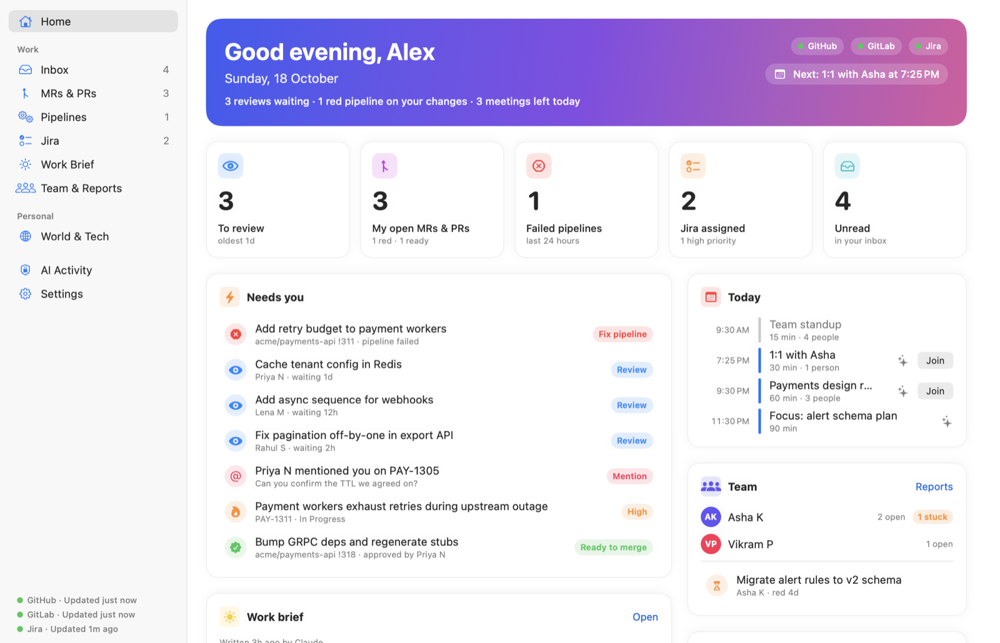
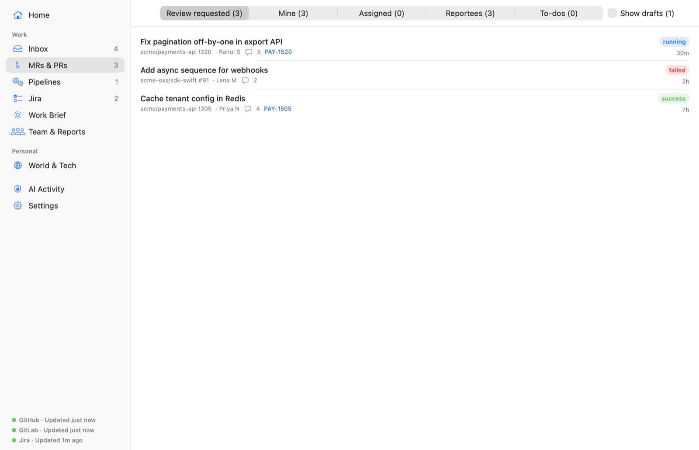
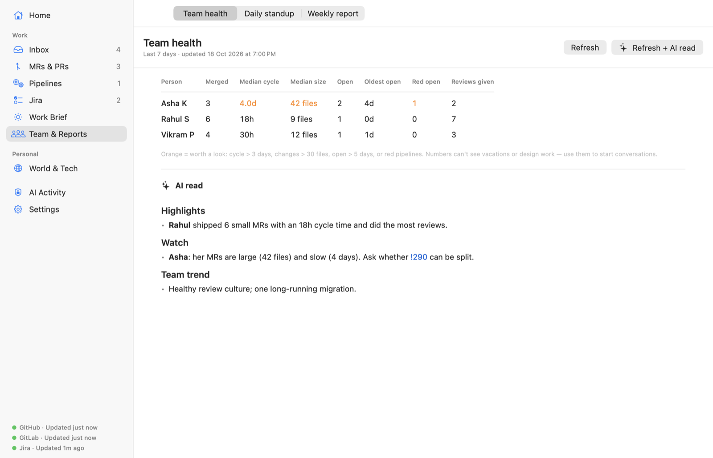
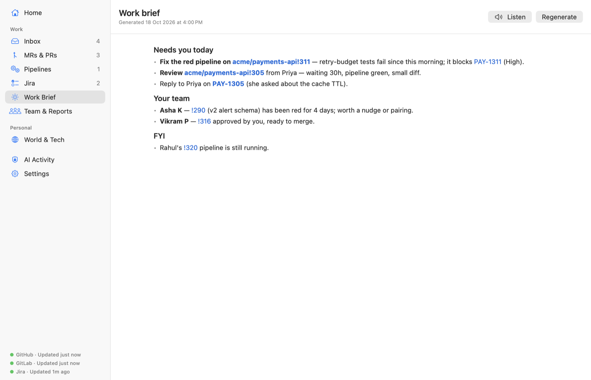
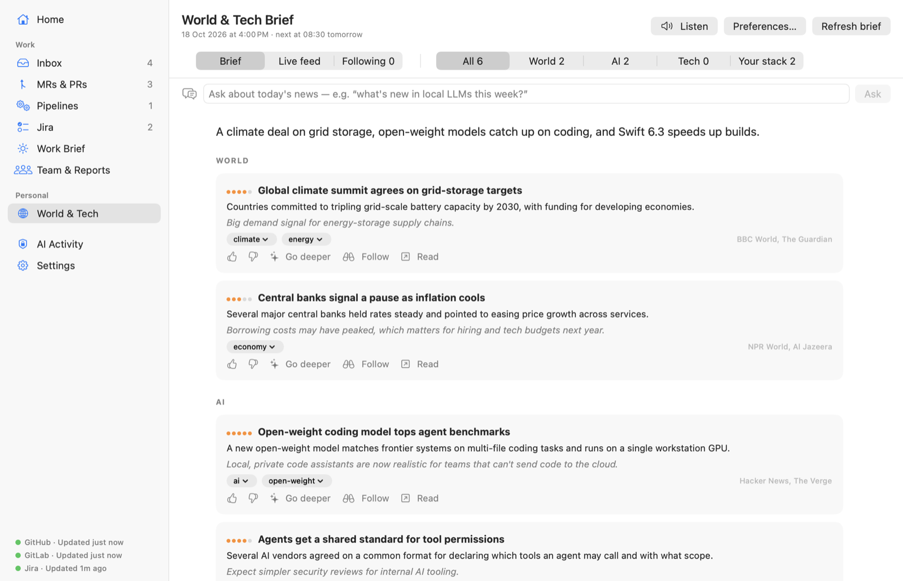
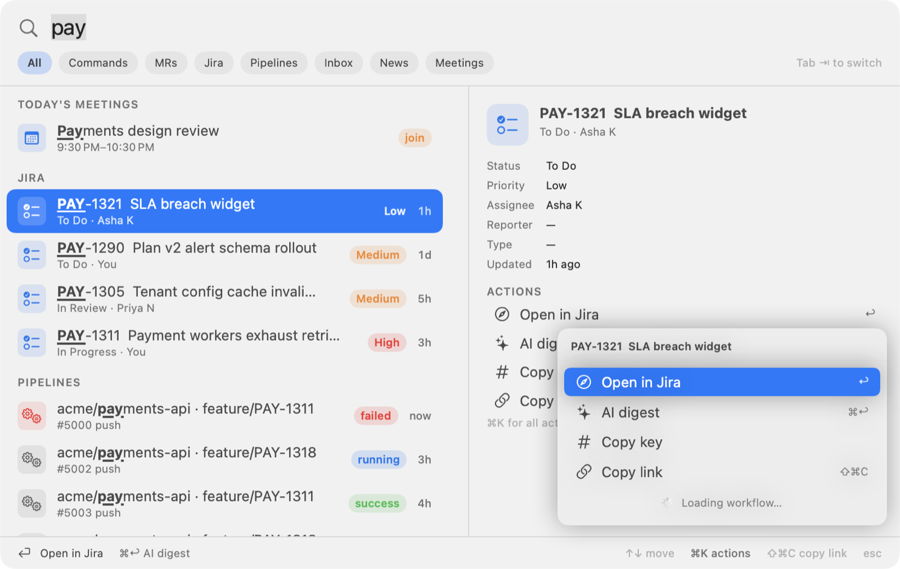
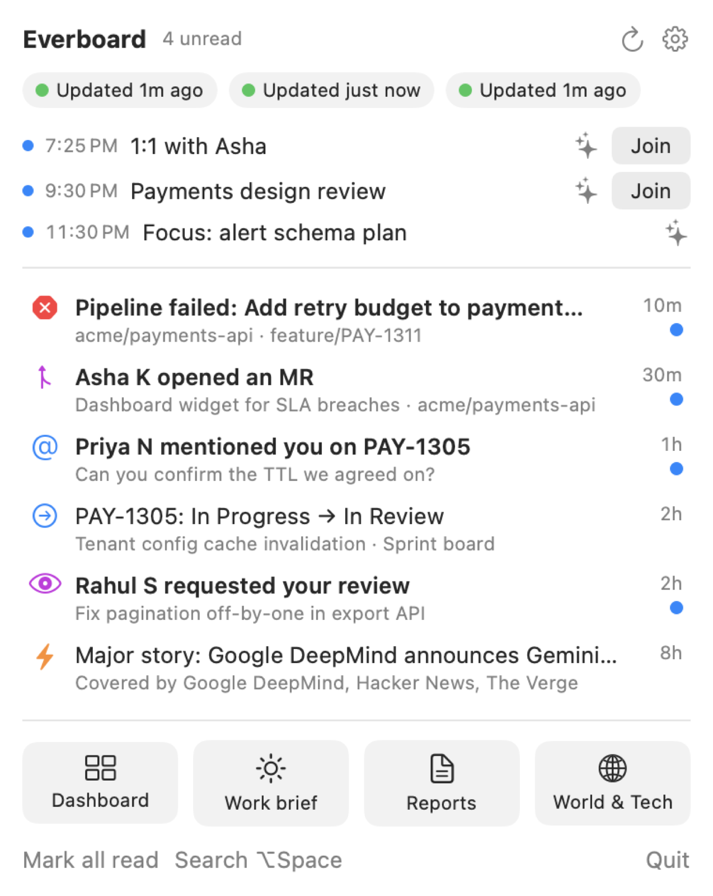

# Everboard

**Your personal command center on macOS.** Everboard keeps track of your team's tickets, pull requests and pipelines across GitLab, GitHub and Jira, tells you what needs you today, and keeps you up to date with a daily world and tech news brief. It all lives in your menu bar.

I built it as the one app I keep open all day: one place to see my own work, my team's work, and what's happening in the world.

<picture>
  <source media="(prefers-color-scheme: dark)" srcset="docs/screenshots/dark/home.png">
  
</picture>

<sub>Screenshots use the built-in demo data (`--demo`), not real accounts.</sub>

## What it does

### Your work and your team's, in one list

- **Merge requests and pull requests** from any number of GitLab and GitHub accounts: gitlab.com, self-hosted GitLab, github.com and GitHub Enterprise, each optionally limited to certain groups or orgs.
- **Review queue, your own changes, and everything your reportees have open**, with pipeline / checks status, approvals and merge blockers.
- **Jira Cloud** issues assigned to you and the filters you choose to watch.
- **Pipelines and GitHub Actions runs** you triggered, failed ones first, with one-click retry.
- **Notifications that respect your focus:** CI failures, new changes from your team, mentions and Jira updates. Low-priority ones are batched, and alerts stay quiet during meetings.

<picture>
  <source media="(prefers-color-scheme: dark)" srcset="docs/screenshots/dark/mrs.png">
  
</picture>

### Team health and reports, written for you

Per-person metrics (cycle time, change size, stuck work, reviews given), plus a daily standup and a weekly report written by Claude from your actual GitLab, GitHub and Jira activity.

<picture>
  <source media="(prefers-color-scheme: dark)" srcset="docs/screenshots/dark/reports.png">
  
</picture>

### A morning brief that tells you what matters

Every morning Claude reads your open changes, pipelines, reviews, team and Jira issues and tells you what needs you first. It can also summarize any MR or PR, digest a long Jira thread, or prep you for your next meeting.

<picture>
  <source media="(prefers-color-scheme: dark)" srcset="docs/screenshots/dark/workbrief.png">
  
</picture>

### Stay current with the world

A personal **World & Tech brief**: Claude picks the stories that matter from world news, AI and your tech stack, explains why each one matters, and learns from your 👍 / 👎. Follow a story to get updates, or ask questions about today's news.

<picture>
  <source media="(prefers-color-scheme: dark)" srcset="docs/screenshots/dark/world.png">
  
</picture>

### Everything a keystroke away

<table>
<tr>
<td width="62%">

<picture>
  <source media="(prefers-color-scheme: dark)" srcset="docs/screenshots/dark/palette-search.png">
  
</picture>

**⌥Space** opens a command palette that searches everything: your changes, Jira, pipelines, inbox, news and meetings, plus live search across every account.

</td>
<td>

<picture>
  <source media="(prefers-color-scheme: dark)" srcset="docs/screenshots/dark/menubar.png">
  
</picture>

The **menu bar** shows your next meetings and latest notifications at a glance.

</td>
</tr>
</table>

### Built to stay out of the way

- Native Swift/SwiftUI, around 40 MB of RAM, and all data stays on your Mac. There's no Everboard server.
- AI features run through your local [`claude` CLI](https://docs.claude.com/en/docs/claude-code), with privacy controls: secrets and emails are redacted, names can be swapped for placeholders, and every prompt sent is logged so you can inspect it.
- Calendar integration, read-aloud for briefs, and a dashboard of your Claude token usage.

> **Status:** personal project, works on macOS 14+ (tested on macOS 26). GitLab (gitlab.com or self-hosted), GitHub (github.com or Enterprise Server) and Jira **Cloud** are supported. Jira Server/Data Center is not.

## Quick start

```bash
git clone <this repo> everboard && cd everboard
cp secrets.env.example secrets.env && chmod 600 secrets.env   # then fill in your values
make install                                                  # builds and installs ~/Applications/Everboard.app
open ~/Applications/Everboard.app
```

You need:
- macOS 14 or later, with the Xcode Command Line Tools (`xcode-select --install`). Full Xcode is optional.
- Optionally, the [`claude` CLI](https://docs.claude.com/en/docs/claude-code), signed in, for the AI features. Everboard finds it automatically.
- Tokens for whichever services you use. Each is optional:

| Variable | What |
|---|---|
| `GITLAB_URL` | `https://gitlab.com` or your self-hosted GitLab (must be HTTPS) |
| `GITLAB_TOKEN` | Personal access token: `read_api` to view, `api` to approve, retry or comment |
| `GITHUB_URL` | `https://github.com` or your GitHub Enterprise Server URL. Setting it turns GitHub tracking on |
| `GITHUB_TOKEN` | Classic token with `repo` + `notifications`. On its own (no `GITHUB_URL`) it only raises rate limits for the "trending repos" news source |
| `GITLAB_ORGS`, `GITHUB_ORGS` | Optional, comma-separated: only track these groups / orgs |
| `GITLAB_<NAME>_URL`, `_TOKEN`, `_ORGS` | More accounts, e.g. `GITLAB_WORK_*`, `GITHUB_OSS_*`. The URL defaults to gitlab.com / github.com |
| `JIRA_URL` | `https://<site>.atlassian.net` |
| `JIRA_EMAIL`, `JIRA_API_TOKEN` | Your Atlassian email and an [API token](https://id.atlassian.com/manage-profile/security/api-tokens) |

These go in `secrets.env` at the project root, or in `~/.config/everboard/secrets.env` if you'd rather keep them outside the checkout (`$EVERBOARD_SECRETS` can point anywhere else). The file is git-ignored and kept at `chmod 600`. Any variable missing from the file is read from the environment, so the CLI also works with plain `export`s. Nothing about your organisation is hard-coded: hosts, emails and tokens all come from these variables.

Then, in **Settings**:
1. **Team:** add your reportees' emails.
2. **Jira:** watch some filters.
3. **Web panels:** add your Jira dashboards.

## Documentation

All the docs are in [`docs/`](docs/README.md):

| Doc | Read it to… |
|---|---|
| [Getting started](docs/getting-started.md) | Install, configure and grant permissions |
| [Features guide](docs/features.md) | Learn what every screen, notification and AI feature does |
| [How it works](docs/architecture.md) | Follow the architecture, data flow and polling/diff engine |
| [Swift primer](docs/swift-primer.md) | Learn Swift, SwiftUI and SwiftPM using this codebase as examples |
| [Build & deploy](docs/build-and-deploy.md) | See how source becomes `Everboard.app` on your Mac, plus updating, signing and uninstalling |
| [AI & token usage](docs/ai-and-usage.md) | See how `claude` is called, what each feature sends, and the costs |
| [Security](docs/security.md) | Read the threat model, the safeguards, and where your data lives |
| [Extending](docs/extending.md) | Add a data source, a screen or a setting |
| [Troubleshooting](docs/troubleshooting.md) | Fix it when something doesn't work |

## Development

```bash
make test                                               # Swift Testing (no Xcode needed)
make build                                              # debug build
open build/Everboard.app --args --demo                  # sample data, no tokens needed
make screenshots                                        # regenerate the README screenshots (light + dark)
swift run everboard-cli check                           # verify tokens and connections
make leakcheck                                          # scan for tokens / personal details before committing
```

## Contributing

Contributions are welcome. See [CONTRIBUTING.md](CONTRIBUTING.md) for setup and guidelines, and [SECURITY.md](SECURITY.md) to report a vulnerability privately.

## License

MIT. See [LICENSE](LICENSE).
